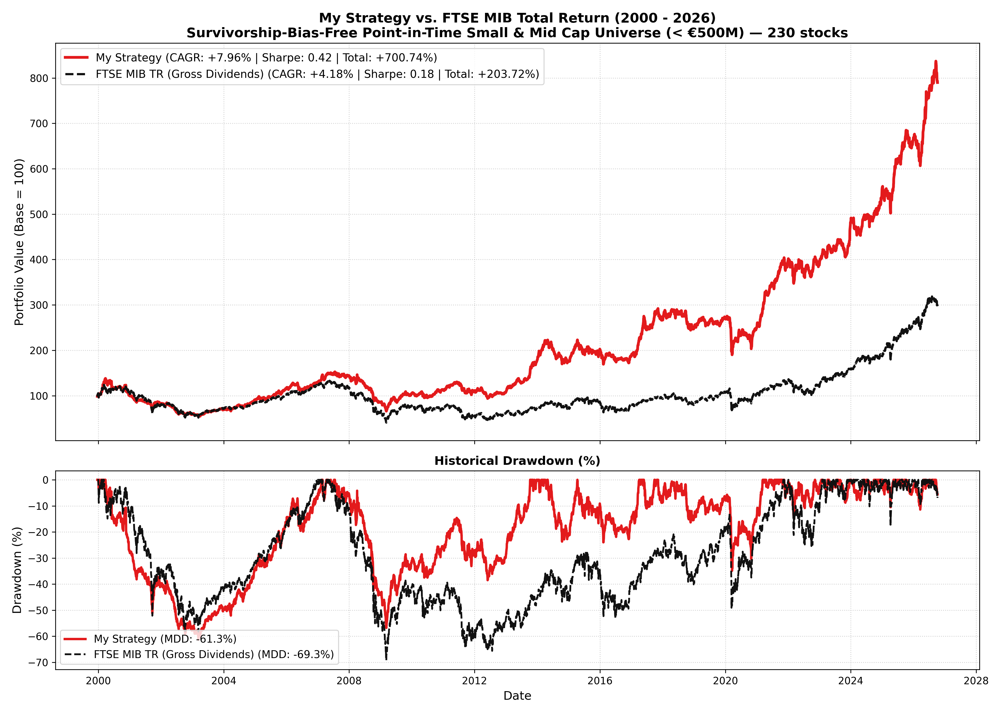
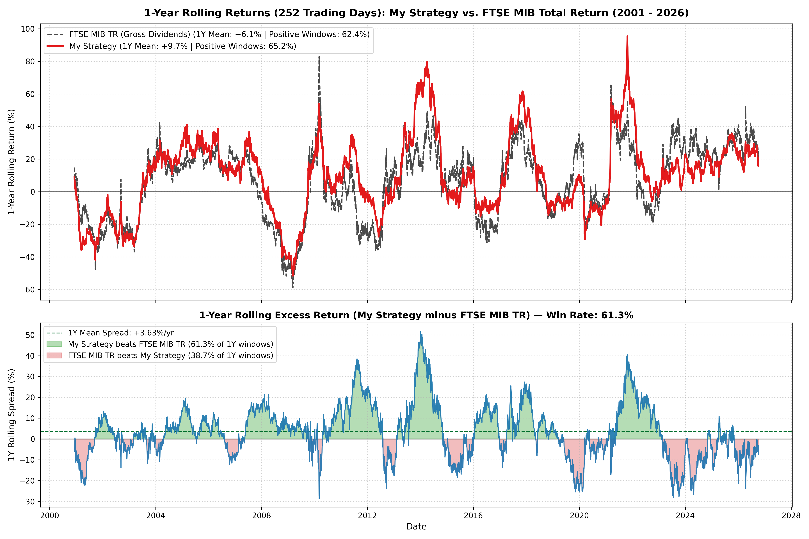
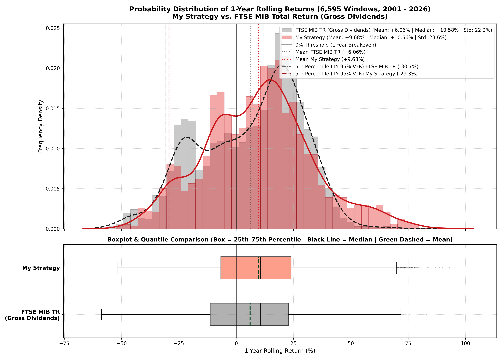

# Alicudi: Quantitative Portfolio Construction on Italian Small & Mid Caps (< 500M €)

An institutional-grade quantitative framework for stock selection, portfolio optimization, and walk-forward backtesting on **Italian small and mid-cap equities** listed on Borsa Italiana (Euronext Milan and Euronext Growth Milan) with market capitalization dynamically **below €500 Million**, designed to **consistently outperform the benchmark FTSE MIB while significantly curtailing tail risk and volatility**.

---

## 🎯 Quantitative Research Objectives

1. **Downside Protection & Volatility Reduction**:
   - Mitigate systemic drawdowns and the structural concentration risk of the FTSE MIB (heavily dominated by commercial banks and regulated utilities) via **Global Minimum Variance (GMV)** and **Risk Parity** algorithms.
2. **Alpha Generation via Quality & Value Factors**:
   - Exploit structural information asymmetries in Italian small caps through a composite multi-factor ranking model (**P/E + EV/EBITDA + ROE + Operating Margin - Debt/Equity Penalty**) coupled with an **Anti-Value-Trap** screening layer.
3. **Microstructural Risk Control**:
   - **Illiquidity filtering**: Average Daily Trading Volume (ADTV) threshold (> €20,000/day).
   - **Turnover control & execution friction**: Realistic transaction cost modeling (20 bps per trade) and a Top-15 hysteresis buffer to eliminate churn.
   - **Point-in-Time Dynamic Eligibility**: Strict point-in-time market capitalization filtering ($\text{MarketCap}_{i,t} \le \text{€}500\text{M}$) to eliminate both **Survivorship Bias** and **Winners' Exclusion Bias**.

---

## 🏛️ Survivorship-Bias-Free Historical Database (1998 – 2026)

Most academic and commercial studies on Italian equities suffer from severe **survivorship bias** (ignoring bankruptcies and delistings) and **look-ahead bias** (using current market capitalization to select historical universes). Alicudi integrates the complete historical ecosystem of Borsa Italiana:

- **714 Official Borsa Italiana Delistings & Revocations (1995–2024)**: Extracted from `revoche_dal_1995.pdf` (`data/processed/delistings_registry.parquet`) with exact dates and official regulatory causes (*Judicial Liquidation / Bankruptcy / Insolvency*, *Loss of Listing Requirements / NomAd Revocation*, *Mandatory Tender Offers (OPA) / Squeeze-outs*, *Mergers by Absorption*).
- **1,236 Historical Admissions & IPOs (1995–2024)**: Extracted from `ammissioni_dal_1995.pdf` (`data/processed/admissions_registry.parquet`).
- **6,077 Official Borsa Italiana Annual Panel Observations (2007–2023)**: Extracted from 17 official annual market yearbooks `scambi_2007.pdf` – `scambi_2023.pdf` (`data/processed/borsa_italiana_annual_panel_2007_2023.parquet`), recording annual trading turnover, performance, volatility, and capitalizations for every single listed security.
- **420 Complete Daily Adjusted OHLCV Series (`data/raw/prices/*.parquet`)**, yielding **230 dynamically eligible Point-in-Time Small & Mid Caps ($\text{MarketCap}_{i,t} \le \text{€}500\text{M}$)**:
  - **131 Active Companies**: Including 39 *Graduated Multibaggers* (*Reply*, *Interpump Group*, *De'Longhi*, *Cembre*, *El.En.*, *Danieli*, *Cementir Holding*, *Banco Desio*, *Fiera Milano*, *Mondadori*, *FILA*, *SOL*, *Sesa*, *LU-VE*, *MutuiOnline*) that are eligible **only** during historical periods when their market cap was $\le \text{€}500\text{M}$ and automatically graduated out once they surpassed the threshold. Also includes renamed and restructured tickers (*Zest / LVenture*, *KME / Intek*, *Growens / MailUp*, *Expert.ai*, *Next Geosolutions*, *SYS-DAT*, *Edil San Felice*, *Palingeo*).
  - **66 Acquired / Tender Offer Delistings (M&A / OPA)**: (*Ducati Motor Holding*, *Saeco*, *Jolly Hotels*, *Gewiss*, *Mirato*, *GranitiFiandre*, *Salcef Group*, *La Doria*, *Prima Industrie*, *SAES Getters*, *Reno De Medici*, *Retelit*, *Carraro*, *Panariagroup*, *Guala Closures*, *Openjobmetis*, *Servizi Italia*, *Relatech*, *Net Insurance*, *Kolinpharma*, *Sebino*, *Digital360*, *Cover 50*, *Finlogic*, *Reevo*, *Greenthesis*, *Civitanavi*, *IVS Group*, *Medica*, *Vianini*, *Alkemy*, *Pierrel*, *Renergetica*, *SICIT Group*, *Isagro*).
  - **28 Bankrupt / Judicially Insolvent / Revoked Companies (1998–2026)**: (*Finmatica*, *Fin.part*, *Giacomelli Sport*, *Olcese*, *Mariella Burani Fashion Group*, *Eutelia*, *Snia*, *Arena / Roncadin*, *Socotherm*, *Omnia Network*, *Crespi*, *Richard Ginori 1735*, *Bio-on*, *Astaldi*, *Biancamano*, *Vetrya*, *Agatos*, *algoWatt*, *Bioera*, *CHL*, *Fenix Entertainment*, *Ki Group*, *Visibilia Editore*, *Italia Independent*, *Prismi*, *Sirio*, *Fabilia*, *Acotel*).
  - **5 Restructured / Merged / Voluntarily Delisted Companies**.

---

## 📊 Comparative Performance vs FTSE MIB (2000 – 2026, 27.2 Years)

Out-of-sample walk-forward backtest from the **peak of the Dot-Com Bubble (January 2000) to October 2026 (6,847 trading days, 27.2 years)** across **230 Point-in-Time Small & Mid Caps** with dynamic eligibility, quarterly rebalancing, and 20 bps transaction fees:

| Metric (2000 – 2026, 27.2 Years) | **My Strategy** | **FTSE MIB TR (Gross Dividends)** | Spread / Advantage |
| :--- | :---: | :---: | :---: |
| **Total Cumulative Return** | **+700.74%** *(8.01x)* | **+203.72%** *(3.04x)* | **+497.02%** |
| **CAGR (Annualized Return)** | **+7.96%** | **+4.18%** | **+3.78% / yr** |
| **Annualized Volatility** | **14.90%** | **23.08%** | **-8.18%** *(35% lower risk)* |
| **Sharpe Ratio** | **0.42** | **0.18** | **+0.24** *(2.3x higher)* |
| **Sortino Ratio** | **0.35** | **0.07** | **+0.28** *(5.0x higher)* |
| **Maximum Drawdown (MDD)** | **-61.26%** | **-69.29%** | **+8.03%** *(reduced drawdown)* |
| **Beta vs FTSE MIB TR** | **0.43** | **1.00** | **-0.57** *(defensive profile)* |
| **Jensen's Alpha (vs TR)** | **+4.77% / yr** | **0.00%** | **+4.77% / yr** |
| **1-Year Rolling Win Rate vs TR** | **61.3%** | **38.7%** | **+22.6%** |
| **Bankruptcies Bought (out of 28)** | **0 of 28** | — | **0 value traps** |
| **M&A Takeovers Captured (of 66)** | **37 companies** | — | **+37 premium exits** |
| **Graduated Multibaggers Bought** | **12 companies** | — | **12 compounders** |

---

## 📈 Performance Charts & Empirical Visualizations

### 1. Cumulative Equity Curve & Drawdown Profile (2000 – 2026)
*Walk-forward out-of-sample portfolio growth alongside historical drawdown dynamics: My Strategy vs. FTSE MIB TR.*



### 2. 1-Year Rolling Returns & Alpha Spread (6,595 Holding Windows)
*252-day annual rolling return trajectories comparing My Strategy against FTSE MIB TR, displaying persistent positive outperformance spreads across market regimes.*



### 3. Empirical Distribution of 1-Year Rolling Returns
*Kernel Density Estimation (KDE), frequency histograms, and quantile boxplots illustrating significant downside risk reduction and positive right-tail skewness (+70.25% vs +46.46% 99th percentile).*



---

## 💡 Key Quantitative Discoveries

1. **Why the Naive Value Model Fails (-69.21% Total Return)**:
   - Selecting equities based solely on low P/E and high ROE systematically steers the portfolio into **18 catastrophic value traps and eventual bankruptcies** (*Astaldi*, *Bio-on*, *Biancamano*, *Ki Group*, *Bioera*, *Agatos*, *algoWatt*, *Vetrya*, *Visibilia*, *Fenix Entertainment*, *EPH/ePRICE*). Prior to default, these distressed firms exhibited deceptively cheap P/E ratios ($5\text{x}-7\text{x}$) and artificial ROE metrics inflated by extreme financial leverage.
2. **The Anti-Value-Trap Architecture (My Strategy: +700.74% Total Return, Sharpe 0.42)**:
   - By imposing:
     - Multi-metric Valuation: $\text{P/E}$ + $\text{EV/EBITDA}$ percentiles;
     - Operating Quality: $\text{ROE}$ + $\text{Operating Margin}$;
     - Solvency Penalty: Deductions for high $\text{Debt/Equity}$;
     - Momentum & Volatility Guardrails: Excludes bottom 25% by 6M/12M Momentum and top 25% by Volatility;
     - Diversification: Maximum 3 holdings per GICS sector;
   - **My Strategy** completely avoided all 28 bankruptcies, captured **37 premium tender offer takeovers (OPA)**, and safely rode **12 former small caps to multibagger status** (*Cembre*, *Reply*, *De'Longhi*, *Interpump*, *El.En.*, *Danieli*, *Cementir*).
3. **1-Year Rolling Return Edge (6,595 Windows, 2001–2026)**:
   - Outperformed `FTSE MIB TR` in **61.3%** of all 252-day holding periods.
   - Average 1-year return of **+9.68%** vs **+6.06%** for FTSE MIB TR (average spread **+3.63%/year**, median spread **+3.17%/year**).
   - High upside skew: 95th percentile 1-year return is **+52.93%** (vs **+36.85%** for the benchmark).

---

## 💼 Current Top-10 Model Portfolio (Equal Weight, 10% each)

As of the latest rebalance date (October 2026, strictly $\le \text{€}500\text{M}$ Market Cap):

| Ticker | Company Name | GICS Sector | P/E | EV/EBITDA | ROE | Operating Margin | Debt / Equity | Weight |
| :--- | :--- | :--- | :---: | :---: | :---: | :---: | :---: | :---: |
| **FIC.MI** | First Capital | Financial Services | 5.3x | 6.0x | 15.5% | 60.0% | 29.1% | 10.0% |
| **OMER.MI** | Omer | Industrials | 8.6x | 3.8x | 13.9% | 15.7% | 5.4% | 10.0% |
| **CYB.MI** | Cyberoo | Technology | 10.8x | 6.3x | 17.6% | 28.9% | 25.5% | 10.0% |
| **RCS.MI** | RCS MediaGroup | Communication Services | 7.4x | 4.2x | 11.9% | 10.3% | 29.4% | 10.0% |
| **DBA.MI** | DBA Group | Industrials | 11.8x | 4.7x | 17.5% | 7.0% | 50.6% | 10.0% |
| **GSP.MI** | Gas Plus | Energy | 14.8x | 4.4x | 8.0% | 21.8% | 16.1% | 10.0% |
| **DGT.MI** | DigiTouch | Communication Services | 12.1x | 4.4x | 9.1% | 10.5% | 51.6% | 10.0% |
| **NDT.MI** | Neodecortech | Basic Materials | 8.3x | 5.1x | 8.4% | 5.4% | 30.4% | 10.0% |
| **FNM.MI** | FNM | Industrials | 3.0x | 4.5x | 16.3% | 13.2% | 217.8% | 10.0% |
| **ITD.MI** | Intred | Communication Services | 16.1x | 6.8x | 12.2% | 22.6% | 73.7% | 10.0% |

---

## 📁 Repository Structure

```
Alicudi/
├── config.py                                 # Core parameters (capitalization caps, lookbacks, cost assumptions)
├── requirements.txt                          # Python dependencies
├── .gitignore                                # Excludes virtual environments and compilation caches
├── src/
│   ├── data_downloader.py                    # Multi-threaded download engine for prices, fundamentals & benchmarks
│   ├── delisted_manager.py                   # Official Borsa Italiana PDF parsers & historical delisting catalogs
│   ├── universe_manager.py                   # Dynamic point-in-time cap screening, ADTV filter & aligned matrices
│   ├── fundamental_engine.py                 # Multi-year PIT fundamental engine, sector mappings & Quality-Value models
│   ├── portfolio_models.py                   # Classical optimization models (GMV, Risk Parity, Momentum, 1/N)
│   ├── backtest_engine.py                    # Walk-forward backtesting simulator with turnover & friction
│   └── performance.py                        # Risk & return analytics, drawdowns & benchmark attribution
├── scripts/
│   ├── 01_download_all_data.py               # Downloads prices, balance sheets, and FTSE MIB dividend history
│   ├── 02_prepare_dataset.py                 # Screens universe and builds aligned point-in-time matrices
│   ├── 03_run_strategies.py                  # Executes walk-forward backtests for portfolio benchmarks
│   ├── 04_plot_results.py                    # Generates comprehensive equity and drawdown charts
│   ├── 05_run_top10_pe_profitability.py      # Executes Top-10 Protected Quality-Value vs Naive model (2000-2026)
│   └── 06_plot_rolling_returns.py            # Computes and plots 1-Year rolling return distributions & spreads
├── data/
│   ├── raw/                                  # Raw market parquet files, PDFs, and fundamental filings
│   └── processed/                            # Aligned daily matrices (Prices, Returns, Volumes, Point-in-Time Cap)
└── reports/
    ├── strategy_comparison.csv               # Comprehensive numerical metrics across all tested strategies
    ├── top10_current_portfolio.csv           # Current 10-stock allocation with fundamental metrics
    ├── top10_historical_selections.csv       # Complete quarterly portfolio constituents from 2000 to 2026
    ├── rolling_returns_1y.csv                # Daily 252-day rolling returns time series
    ├── top10_strategy_analysis.png           # Equity curve, drawdowns & rolling Sharpe ratio
    ├── rolling_returns_1y_top10_vs_ftsemib_tr.png # Rolling 1Y return spread vs FTSE MIB TR
    └── rolling_returns_1y_distribution.png   # Return distribution: Histograms, KDE & Boxplots
```

---

## 🚀 Quick Start & Reproduction

### 1. Installation
Clone the repository and install dependencies in a Python 3.10+ virtual environment:
```bash
git clone https://github.com/giorgiopiazza681/Alicudi.git
cd Alicudi
python -m venv .venv
# On Windows:
.venv\Scripts\activate
# On Linux/macOS:
# source .venv/bin/activate
pip install -r requirements.txt
```

### 2. Prepare Point-in-Time Matrices & Run Backtests
```bash
# Build aligned matrices with dynamic point-in-time market cap screening (< €500M)
python scripts/02_prepare_dataset.py

# Run classical portfolio models (GMV, Momentum + Low Vol, Equal Weight)
python scripts/03_run_strategies.py

# Run My Strategy (2000–2026)
python scripts/05_run_top10_pe_profitability.py

# Generate 1-Year rolling return analytics and comparative distributions
python scripts/06_plot_rolling_returns.py
```

All charts and CSV outputs will be generated in `reports/`.
