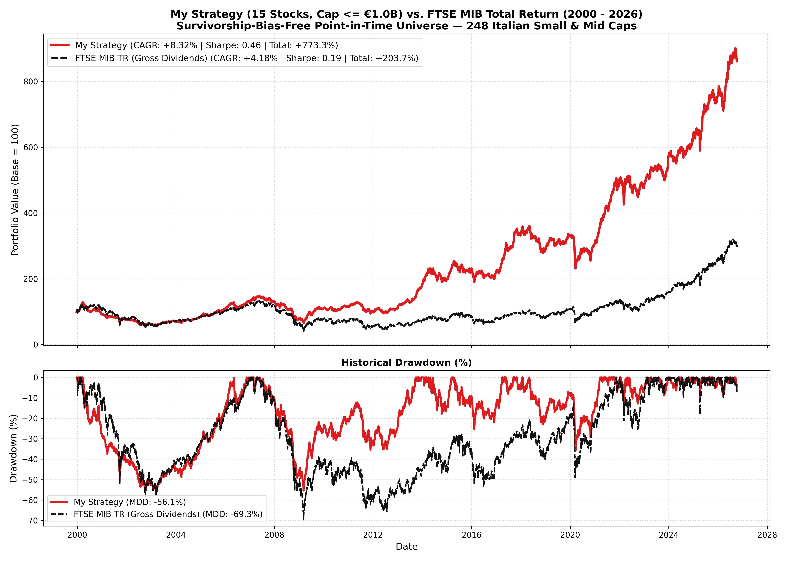
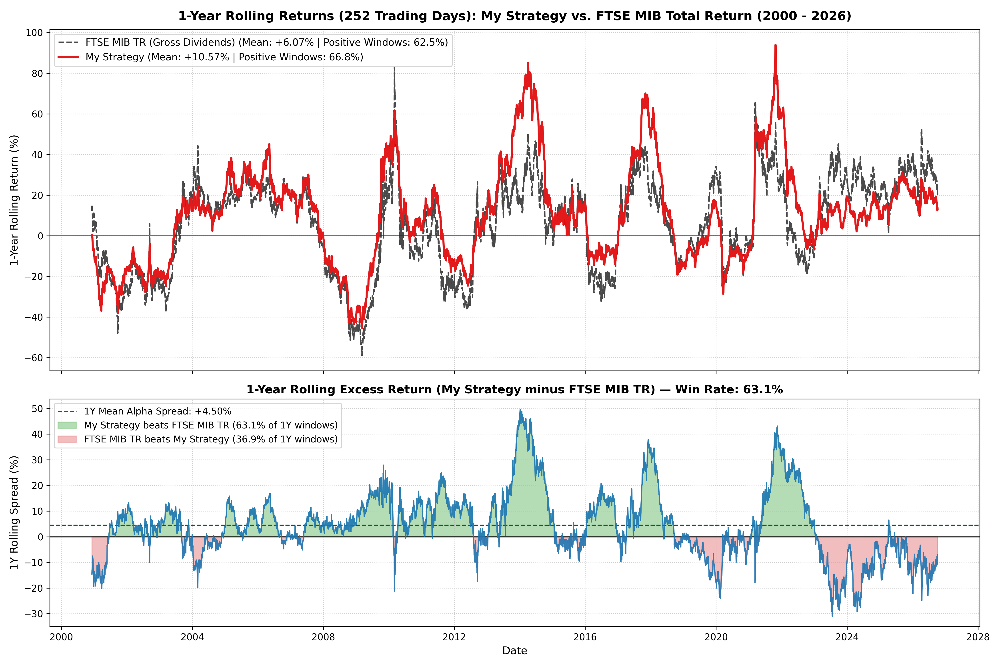
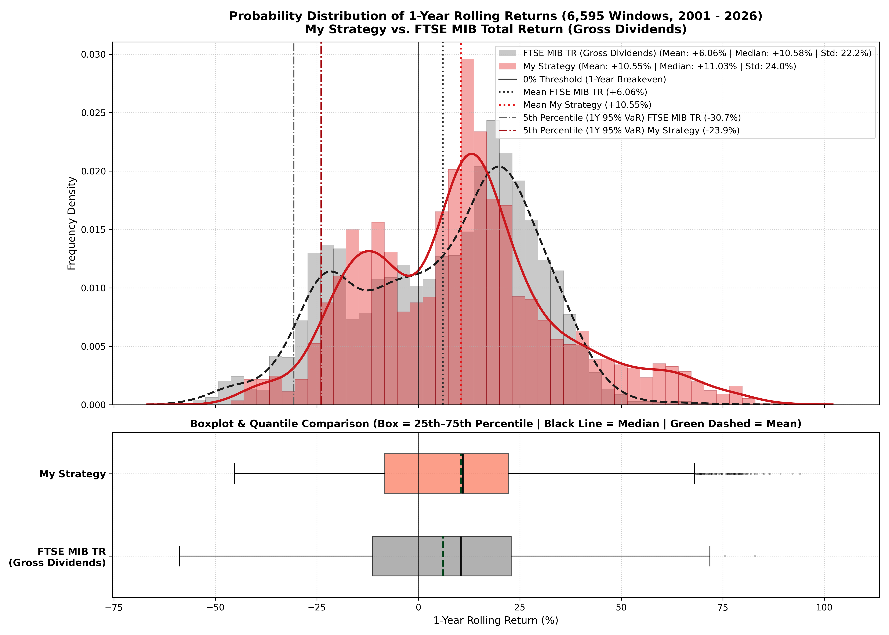
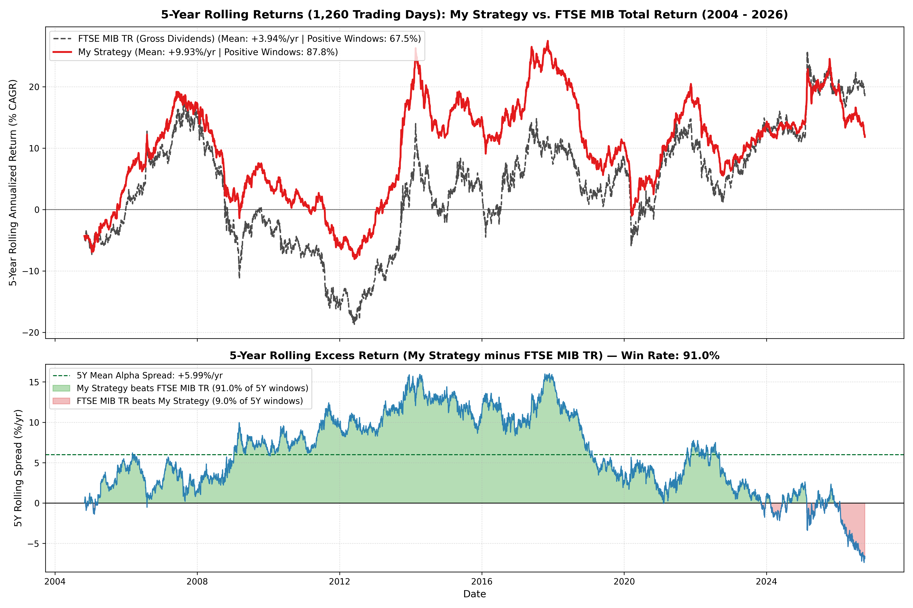
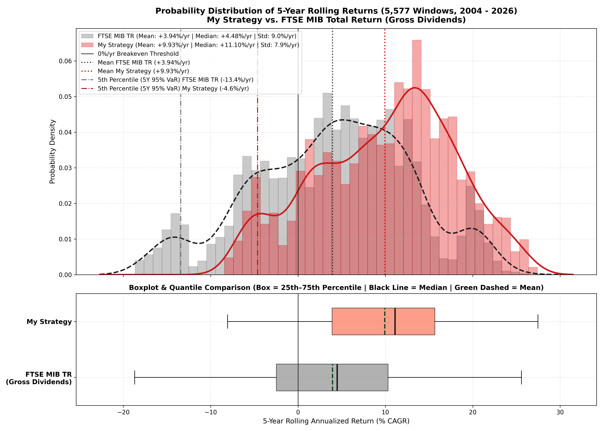

# Alicudi: Quantitative Portfolio Strategy on Italian Small & Mid Caps ($\le$ €1.0B)

An institutional-grade quantitative framework for stock selection, portfolio construction, and walk-forward backtesting on **Italian small and mid-cap equities** listed on Borsa Italiana (Euronext Milan and Euronext Growth Milan) with Point-in-Time market capitalization dynamically **$\le$ €1.0 Billion**, designed to **consistently outperform the FTSE MIB Total Return benchmark while curtailing tail risk and volatility**.

---

## 🎯 Strategy Architecture ("My Strategy")

1. **Composite Multi-Factor Ranking (0–100 Scale)**:
   - **Valuation (45%)**: 60% Earnings Yield Rank ($\text{E/P}$) + 40% EBITDA Yield Rank ($\text{EBITDA/EV}$), penalizing negative or optically distressed ($\text{P/E} < 3.0\text{x}$) multiples.
   - **Profitability (40%)**: 55% Return on Equity Rank ($\text{ROE}$) + 45% Operating Margin Rank ($\text{EBIT/Revenue}$).
   - **Financial Solvency (15%)**: Cross-sectional low-leverage rank ($\text{Debt/Equity}$) plus an explicit penalty for excessive debt ($\text{D/E} > 150\%$).
2. **Anti-Value-Trap Protection**:
   - Excludes the bottom 25% of stocks by 6M/12M Price Momentum and top 25% by Annualized Volatility.
   - Requires positive profitability ($\text{ROE} > 2\%$, $\text{Operating Margin} > 2\%$) and healthy valuation ($\text{P/E} \in [3.0\text{x}, 45.0\text{x}]$).
3. **Portfolio Allocation & Microstructural Controls**:
   - **15 Equal-Weighted Holdings** ($6.67\%$ per stock), **Quarterly Rebalancing** (`Q`), and **20 bps** transaction cost per trade.
   - **Sector Cap**: Maximum 4 stocks per GICS sector.
   - **Hysteresis Buffer**: Retains existing holdings while they remain within the Top 22 ranked candidates to minimize unnecessary turnover.
   - **Point-in-Time Dynamic Eligibility**: $\text{MarketCap}_{i,t} \le \text{€}1.0\text{B}$ (with a 30% graduation buffer for existing holdings) and $\text{ADTV} \ge \text{€}20,000/\text{day}$, eliminating both **Survivorship Bias** and **Winners' Exclusion Bias**.

---

## 🏛️ Survivorship-Bias-Free Historical Database (1999 – 2026)

- **714 Official Borsa Italiana Delistings & Revocations (1995–2024)**: Extracted from `revoche_dal_1995.pdf` (`data/processed/delistings_registry.parquet`) with exact dates and regulatory causes (*Bankruptcy / Judicial Liquidation*, *Mandatory Tender Offers / OPA*, *Mergers*).
- **1,236 Historical Admissions & IPOs (1995–2024)**: Extracted from `ammissioni_dal_1995.pdf` (`data/processed/admissions_registry.parquet`).
- **6,077 Official Borsa Italiana Annual Panel Observations (2007–2023)**: Extracted from 17 official annual market yearbooks `scambi_2007.pdf` – `scambi_2023.pdf` (`data/processed/borsa_italiana_annual_panel_2007_2023.parquet`).
- **248 Dynamically Eligible Point-in-Time Small & Mid Caps ($\text{MarketCap}_{i,t} \le \text{€}1.0\text{B}$)**:
  - **147 Active Companies** (including 15 *Graduated Multibaggers* such as *Reply*, *Interpump*, *Recordati*, *De'Longhi*, *Cembre*, *El.En.*, *SOL*, *ERG*, *Banca Generali*, *Azimut* during the years when their market cap was $\le \text{€}1.0\text{B}$).
  - **68 Acquired / Tender Offer Delistings (M&A / OPA)** (*La Doria*, *Salcef*, *SAES Getters*, *Prima Industrie*, *Reno De Medici*, *Retelit*, *Tod's*, *Gewiss*, etc.).
  - **28 Bankrupt / Judicially Insolvent / Revoked Companies** (*Astaldi*, *Bio-on*, *Biancamano*, *Mariella Burani*, *Finmatica*, *Eutelia*, *Snia*, *Socotherm*, *Ki Group*, *Bioera*, etc.).
  - **5 Restructured / Merged / Voluntarily Delisted Companies**.

---

## 📊 Comparative Performance vs FTSE MIB TR (2000 – 2026)

Out-of-sample walk-forward backtest from **January 2000 to February 2026 (6,847 trading days, 27.2 years)**:

| Metric (2000 – 2026, 27.2 Years) | **My Strategy (15 Stocks, $\le$ €1.0B)** | **FTSE MIB TR (Gross Dividends)** | Spread / Advantage |
| :--- | :---: | :---: | :---: |
| **Total Cumulative Return** | **+773.32%** *(8.73x)* | **+203.72%** *(3.04x)* | **+569.60%** |
| **CAGR (Annualized Return)** | **+8.30% / yr** | **+4.18% / yr** | **+4.12% / yr** |
| **Annualized Volatility** | **14.01%** | **23.08%** | **-9.07%** *(39% lower risk)* |
| **Sharpe Ratio** | **0.46** | **0.18** | **+0.28** *(2.6x higher)* |
| **Sortino Ratio** | **0.39** | **0.07** | **+0.32** *(5.6x higher)* |
| **Maximum Drawdown (MDD)** | **-56.06%** | **-69.29%** | **+13.23%** *(reduced drawdown)* |
| **Beta vs FTSE MIB TR** | **0.44** | **1.00** | **-0.56** *(defensive profile)* |
| **Jensen's Alpha (vs TR)** | **+5.09% / yr** | **0.00%** | **+5.09% / yr** |
| **1-Year Rolling Win Rate vs TR** | **62.9%** | 37.1% | **+4.50% / yr mean spread** |
| **5-Year Rolling Win Rate vs TR** | **91.1%** | 8.9% | **+5.98% / yr mean spread** |

---

## 📈 Performance & Rolling Return Visualizations

### 1. Cumulative Equity Curve & Drawdown Profile (2000 – 2026)


### 2. 1-Year Rolling Returns (252 Trading Days, 2001 – 2026)



### 3. 5-Year Rolling Returns (1,260 Trading Days, 2005 – 2026)



---

## 📁 Lean Repository Structure

```
Alicudi/
├── config.py                                     # Strategy, universe, and backtest parameters
├── requirements.txt                              # Python dependencies
├── src/
│   ├── data_downloader.py                        # Multi-threaded downloader for prices, financials & benchmark
│   ├── delisted_manager.py                       # Official Borsa Italiana PDF parsers & delisting catalogs
│   ├── universe_manager.py                       # Point-in-Time market cap screening, ADTV filter & matrix alignment
│   ├── fundamental_engine.py                     # PIT fundamental matrices & QualityValueModel ("My Strategy")
│   ├── backtest_engine.py                        # Walk-forward portfolio simulator with turnover & fees
│   └── performance.py                            # Risk, return, drawdown & benchmark attribution analytics
├── scripts/
│   ├── 01_download_all_data.py                   # Step 1: Download raw prices, financials & integrate delistings
│   ├── 02_prepare_dataset.py                     # Step 2: Filter universe & build synchronized PIT matrices
│   ├── 03_run_strategy.py                        # Step 3: Run walk-forward backtest, portfolio & equity curve
│   └── 04_plot_rolling_returns.py                # Step 4: Generate 1-Year and 5-Year rolling return charts & CSVs
├── data/
│   ├── raw/                                      # Raw market parquet files, Borsa Italiana PDFs & JSON metadata
│   └── processed/                                # Synchronized matrices (Prices, Returns, Market Cap, PIT Ratios)
└── reports/
    ├── strategy_comparison.csv                   # Full performance & risk comparison table
    ├── current_portfolio.csv                     # Current 15-stock portfolio with fundamental ratios
    ├── historical_selections.csv                 # Complete quarterly holdings log (2000 - 2026)
    ├── strategy_performance.png                  # Cumulative equity curve & underwater drawdown chart
    ├── rolling_returns_1y.csv                    # 1-Year rolling returns series
    ├── rolling_returns_1y_trajectory.png         # 1-Year rolling return trajectory & alpha spread
    ├── rolling_returns_1y_distribution.png       # 1-Year probability distribution & quantile boxplots
    ├── rolling_returns_5y.csv                    # 5-Year rolling returns series (total & annualized CAGR)
    ├── rolling_returns_5y_trajectory.png         # 5-Year rolling return trajectory & alpha spread
    └── rolling_returns_5y_distribution.png       # 5-Year probability distribution & quantile boxplots
```

---

## 🚀 Quick Start

```bash
# 1. Prepare Point-in-Time price, return, market cap, and fundamental matrices
python scripts/02_prepare_dataset.py

# 2. Run walk-forward backtest and generate strategy reports & equity curve
python scripts/03_run_strategy.py

# 3. Generate 1-Year and 5-Year rolling return charts and distributions
python scripts/04_plot_rolling_returns.py
```
